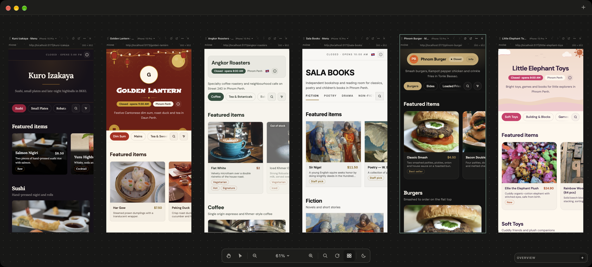
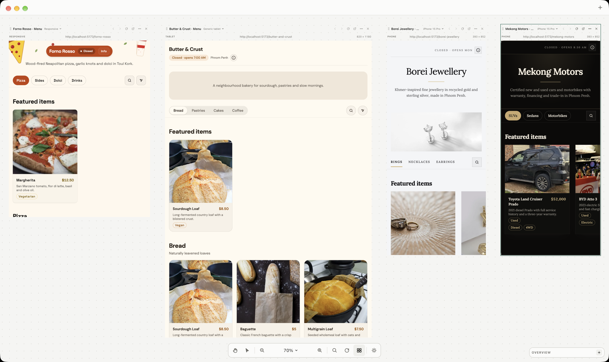

# BrowserDeck

**Multiple real browser sessions. One flexible workspace.**

BrowserDeck is a local-first macOS desktop application for developers, designers, and QA teams who need to open, arrange, resize, and interact with multiple independent browser sessions at once.

> **Terminology:** The application UI calls each browser frame a **browser**. The code and architecture notes retain **pane** for the underlying native `WebContentsView`; **device** is reserved for viewport/emulation details such as device pixel ratio.

> **Name:** BrowserDeck 1.2.0 is the current development version; 1.1.0 is the latest published Homebrew release. The local 1.0.0 build was developed as PaneFlow; startup migrates the old app-data directory and browser partitions.

> **Project status:** BrowserDeck 1.2.0 is the current source version. It is a working Electron/Vue browser workspace with isolated persistent sessions, a Canvas-only workspace with world-space snapping, a custom browser menu and canvas context menu, native-aware view hiding, native Browser-menu commands, per-browser viewport emulation, workspace persistence and management, safe window bounds, per-pane session release on close, persisted system/light/dark themes, unsigned arm64 macOS packaging, repeated-switch leak stress, workspace import/export, active-pane accessibility, automated Playwright/CDP/axe accessibility audits, a 50-cycle loaded-page soak, and a security-hardened shell/IPC/session boundary. Post-1.0 hardening covers a VoiceOver/manual screen-reader pass, longer CPU/memory profiling, Windows/Linux packaging, and signed/notarized distribution once Apple Developer credentials exist. See [`SECURITY.md`](./SECURITY.md).

## Screenshots



Six independent browser sessions arranged together on the Canvas.



Responsive, tablet, and phone viewports sharing one workspace in the light theme.

## Current capabilities

- Electron `BaseWindow` with a trusted Vue shell and native `WebContentsView` browser panes.
- Two browser panes by default; add, duplicate, and close panes dynamically. The quiet toolbar **+** control opens a custom browser menu with responsive, iPhone, Samsung, Pixel, iPad, Galaxy Tab, desktop, and MacBook presets. Each browser header's viewport trigger opens the same custom menu and complete preset catalog for that pane. Duplicates copy URL/viewport into an independent session and land beside or below their source.
- One internally generated persistent browser session per pane, owned by that pane and released when it closes.
- Independent navigation, address bar, history, reload, loading, and load-error states. Each browser header has two rows: title, viewport, and actions on top, with the viewport class, centered address bar, and resolution beneath it. Rotate viewport and capture screenshot live in the actions menu.
- Per-browser in-shell actions menu for back/forward/reload, copy URL, open in the system browser, rotate viewport, screenshot, duplicate, rename, clear site data, DevTools, and close, using the same menu component as the + browser menu.
- **Open multiple browsers…** from the Add browser menu or the empty state: paste one URL per line, choose a default viewport, and create up to 50 independent browsers at once. The viewport defaults to the selected browser and is remembered for the next batch.
- Marquee selection now exposes common actions in the top toolbar: change the viewport for every selected browser and reload selected browsers. Plain click and `Cmd`/`Ctrl`+click toggle a pane in the same selection without dragging, and selected panes use the same frame as the active browser. Clicking empty canvas clears the selection in both the persistent and temporary tools; `Delete` closes the selected set. Hold `Cmd` (macOS) or `Ctrl` (Windows/Linux) while shell chrome has focus to activate the Select tool temporarily, like holding Space for Hand.
- Retina-correct bounds synchronization verified at `devicePixelRatio: 2`.
- Denied popups, permissions, downloads, display capture, and device access for remote content, with transient in-browser notices so blocked actions are visible. Sandboxed browser views have no app bridge or Node access.
- Trusted shell served over a secure internal `browserdeck://shell/` protocol with a production CSP that has no development network allowance, plus IPC sender document validation.
- Independent authenticated sessions on one local origin, with HttpOnly persistent cookies, localStorage, and IndexedDB isolated per pane and restored after restart.
- Canvas-only workspace: pane headers drag panes in world coordinates, with a 16px-gap snap stop, a flush snap, and dashed proximity previews as panes get close.
- Pure TypeScript canvas and viewport helpers for frame sizing, world-space snapping, viewport validation, fit scaling, and minimap projection.
- Native **Browser** menu commands for add, close, reload selected/all, focus address, and find browser, with the selected browser inferred from shell/native focus.
- Custom in-shell **+** browser menu, browser actions menu, and right-click canvas menu. When a menu overlaps a native pane, that pane's view is hidden and its snapshot remains; uncovered panes stay live. Menus support keyboard arrows, Enter, Escape, and click-outside dismissal. The minimap and bottom bar stay visible unless the open menu actually covers them.
- Per-browser viewport emulation with responsive, iPhone 15 Pro/Pro Max/SE, Samsung Galaxy S24/S24 Ultra, Google Pixel 8/8 Pro, iPad Pro 12.9″/Air, Samsung Galaxy Tab S9, laptop, MacBook Air, desktop, and custom width/height/DPR presets. New panes can start with any preset from the **+** menu. Page values are verified inside the fixture pages, fixed presets send a matching iPhone/iPad/Android/desktop user agent so sites serve the intended layout. Phone/tablet presets also use mobile metrics and five-point touch emulation, producing mobile scrollbars and `hover: none`/`pointer: coarse`. Panes can use different presets simultaneously.
- Versioned workspace persistence: pane IDs, profile references, URLs, viewport settings, pane order, layout mode, world-coordinate canvas positions, and legacy grid/freeform fields restore after restart. Legacy arrangements are normalized to Canvas. Active pane sessions survive restarts; closing a pane releases its session.
- Safe window restoration: normal bounds, maximized state, and full-screen state restore after restart when the saved normal bounds remain visible on a connected display.
- Hidden-inset macOS title bar: traffic lights sit inside the compact toolbar, the shell fills the full window content, and empty toolbar space drags the window.
- Compact two-row browser chrome with a frameless surface and a subtle selected-browser outline. The top row carries title, viewport, navigation, actions, and close; the second row shows the viewport class and resolution around that pane's centered address bar. Controls stay available at every Canvas zoom.
- Canvas is the only workspace layout. It has a dotted infinite backdrop below a minimal opaque top toolbar with only Add, background drag and Hand-tool panning, Space as a temporary Hand tool, draggable pane headers with a visible grip that cannot be pushed above the top workspace edge, a marquee Select tool for closing several browsers at once, two-stage world-space snapping, 25–200% wheel zoom around the cursor, a per-browser header viewport trigger that opens the same custom preset menu as Add, a bottom canvas bar with Hand, Select, zoom, find-device, reload-all, Arrange, and appearance controls, an always-visible native overview in the bottom-right, one-click Fit all browsers that keeps panes clear of the bottom bar, per-workspace camera and selection restore, click-empty-canvas deselection, world-coordinate pane positions, and captured pane snapshots while the world moves. Canvas zoom scales the whole pane as a unit while the declared viewport size stays fixed. The overview shows the current viewport, focuses or recenters from a click, and collapses to a compact header. Page content stays interactive when the pane is fully visible; viewport bezels and pane frame resizing are not implemented.
- Custom **+** add menu, bottom-bar Arrange menu, and right-click canvas menu with the compact menu language: sections, monochrome icons, dimension/shortcut metadata, checked Hand/Appearance states, keyboard navigation, and Escape dismissal. Arrange offers Showcase, Horizontal row, 2 × 2 grid, and Vertical stack layouts, then fits the camera to the result.
- Persisted System/Light/Dark theme from the bottom canvas bar appearance menu, custom canvas menu, and native View menu, with matching window chrome and shell tokens. Loaded website panes receive the effective appearance as a live `prefers-color-scheme` change without reloading. The **Workspace** manager lives in the native menu bar; Add remains in the top toolbar, while Find browser and Reload all live in the bottom canvas bar. Address validation errors are shown inline in the pane header and announced through a live status region. A bottom-bar magnifier button and `Cmd/Ctrl+K` open a searchable browser palette that filters by title, hostname, and viewport, with match highlighting and a compact viewport badge.
- Atomic workspace writes with corrupt-file preservation, plus profile metadata reconciliation for referenced profile IDs.
- **Clear Site Data…** in the browser actions menu, with confirmation; clears that pane's cookies, storage, cache, and auth state, then reloads it.
- Workspace manager for create, rename, duplicate, switch, delete, and secret-free import/export. Imported/duplicated workspaces receive independent sessions.
- Repeated workspace-switch stress coverage that verifies webContents and native-view cleanup against a baseline, with a configurable loaded-page soak (50 cycles observed).
- Automated accessibility coverage for the shell toolbar, pane cards, and workspace dialog: accessible roles and names, focus order and visible focus, dialog focus traps and focus return, Chromium CDP accessibility-tree checks, and axe-core WCAG/best-practice audits. Axe is injected through CDP because the production CSP deliberately blocks inline scripts.
- Deterministic local fixture server, unit tests, and two Playwright Electron tests covering Canvas snapping and arrangements, anchored duplicate placement, the custom add/context menus, viewport presets, per-browser viewport controls, open-in-browser handoff, per-pane Clear Site Data, native-view hiding under menus, viewport emulation, a full workspace/session restart, workspace management, and the accessibility audit.

The current build does **not** include arbitrary per-pane user-agent overrides, background-warm workspace switching, or signed/notarized distribution. Fixed viewport presets do send a category-appropriate UA for mobile layout fidelity. See the roadmap in [`SPEC.md`](./SPEC.md).

## Development prerequisites

- macOS for the initial development target.
- Git.
- Node.js 24 (use the version in `.nvmrc`).
- npm.
- GNU Make (included with the macOS developer tools).
- [OpenCode 2](https://opencode.ai/) installed and configured with a coding model.

The verified environment is Node 24.22.3, npm 11.19.1, Electron 45.3.4, and macOS 27.2.1 on Apple silicon.

## Run BrowserDeck

```bash
nvm use
make dev
```

`make dev` checks the Node.js version, installs dependencies when `package.json` or `package-lock.json` has changed, downloads the Electron runtime when needed, and starts a local fixture server on a random loopback port. Two panes open with independent fixture sessions (`alice` and `bob`) that display their per-pane cookie, localStorage, viewport, and device pixel ratio. Open `/login` in a pane to try the fixture's independent authenticated sessions.

To launch the packaged BrowserDeck app with its real name and icon, run `make start`. This builds and packages the unpacked arm64 app, then runs it. `make preview` remains available for the faster Electron dev-runtime preview. Run `make` or `make help` to list every target. A separate `npm install` is not normally required; use `make install` to force a clean reinstall.

The development runtime (`make dev` and `make preview`) uses the shared Electron bundle, so macOS may still label that process “Electron” in the Dock even though it now receives the BrowserDeck icon. `make start` uses `dist/mac-arm64/BrowserDeck.app` and shows the final BrowserDeck name and icon.

### Install with Homebrew

The release is available through the `kanharithsok/tap` tap:

```bash
brew tap kanharithsok/tap
brew trust kanharithsok/tap
brew install --cask browser-deck
```

Or install directly without a separate tap command:

```bash
brew install --cask kanharithsok/tap/browser-deck
```

The cask is arm64-only, requires macOS Sonoma or later, removes the download quarantine flag for this unsigned/ad-hoc build, and installs `BrowserDeck.app` into `/Applications`.

## Commands

| Make target | npm script | Purpose |
| --- | --- | --- |
| `make dev` | `npm run dev` | Fixture server + electron-vite development app |
| `make start` | `npm run start` | Build, package, and launch the real BrowserDeck app |
| `make preview` | `npm run preview` | Build and preview through the Electron dev runtime |
| `make build` | `npm run build` | Build main, preload, and renderer into `out/` |
| `make typecheck` | `npm run typecheck` | Strict TypeScript check for node and renderer code |
| `make lint` | `npm run lint` | ESLint across source, tests, and scripts |
| `make check-contrast` | `npm run check:contrast` | WCAG contrast checks for light/dark design tokens |
| `make test-unit` | `npm run test:unit` | Vitest unit tests |
| `make test` | `npm run test:unit` | Alias for the unit suite |
| `make test-e2e` | `npm run test:e2e` | Build, then run the Playwright Electron integration test |
| `make check` | — | Typecheck, lint, unit tests, and contrast checks |
| `make package` | — | Build the unpacked arm64 `.app` (alias for `package-dir`) |
| `make package-mac` | `npm run package:mac` | Build an unsigned arm64 DMG + ZIP under `dist/` |
| `make package-dir` | `npm run package:dir` | Build the unpacked arm64 `.app` under `dist/` |
| `make install` | — | Force `npm ci` and an Electron runtime install |

## Packaging

`npm run package:mac` produces `dist/BrowserDeck-1.2.0-arm64.dmg`, a matching ZIP, and `dist/mac-arm64/BrowserDeck.app`. The bundle uses `com.kanharithsok.browser-deck`, is arm64-only, and is **unsigned/ad-hoc**. It is suitable for local verification, not notarized distribution. Gatekeeper may block it on other machines until it is signed with a Developer ID Application certificate and notarized.

Packaging applies Electron fuses that disable `ELECTRON_RUN_AS_NODE`, Node options and inspector arguments, and `file://` extra privileges, while enabling ASAR integrity validation and load-only-from-ASAR. These controls reduce accidental local privilege paths; they do not replace code signing. See [`SECURITY.md`](./SECURITY.md) for the threat model and the full packaging checklist.

The published Homebrew cask is `kanharithsok/tap/browser-deck` and points at the arm64 ZIP release asset with a pinned SHA-256 checksum.

## Shortcuts

| Shortcut | Action |
| --- | --- |
| `Cmd/Ctrl+N` | Open the Add Browser picker |
| `Cmd/Ctrl+D` | Duplicate selected browser (placed beside or below the source) |
| `Delete` / `Backspace` | Close selected browser (when shell chrome has focus) |
| `Cmd/Ctrl+Shift+W` | Close selected browser |
| `Cmd/Ctrl+K` | Find a browser |
| `Cmd/Ctrl+L` | Focus the selected browser address |
| `Cmd/Ctrl+R` | Reload selected browser |
| `Cmd/Ctrl+Alt+Shift+R` | Reload all browsers |
| `Cmd/Ctrl+=` | Zoom the Canvas in |
| `Cmd/Ctrl+-` | Zoom the Canvas out |
| `Cmd/Ctrl+0` | Reset the Canvas zoom to 100% |
| `Cmd/Ctrl+Shift+]` | Next workspace |
| `Cmd/Ctrl+Shift+[` | Previous workspace |
| Hold `Cmd` / `Ctrl` | Temporarily activate the Select tool while shell chrome has focus |
| Hold `Space` | Temporarily activate the Hand tool while shell chrome has focus |

Workspace cycling follows workspace name order, wraps at either end, and restores the target workspace's saved browsers and layout. Both items are disabled when only one workspace exists. The selected browser follows shell chrome focus and native pane focus. Shortcuts are registered through the native Browser, Workspace, and View menus, except `Delete`/`Backspace`, which is handled by the trusted shell and ignores text-entry focus.

## Testing

```bash
make check
make test-e2e
```

The e2e tests launch the built app against local fixtures and verify:

- two panes with distinct persistent sessions and isolated cookies/localStorage/IndexedDB;
- two independent fixture accounts signed in on the same origin, HttpOnly session cookies, and logout isolation;
- no `window.browserdeck`, `require`, or `process` in remote pages;
- shell CSP blocking inline script and cross-origin fetch, the internal shell protocol, and rejection of IPC from a separate node-enabled webContents;
- blocked remote `file:`/`data:` navigation, denied popups and notifications;
- Canvas-only startup, persistent overview, pane-header dragging, dashed proximity previews, a 16px-gap snap stop, flush snapping, and guide cleanup;
- custom **+** browser menu creation, section/dimension rendering, Escape dismissal, and selected-preset verification;
- right-click canvas menu actions for adding a pane, toggling Hand mode, and switching appearance;
- native view hiding only where a menu overlaps, with live views restored after close;
- native view bounds matching shell content rectangles before and after window resize;
- menu command routing for add/close actions, including `Cmd/Ctrl+N` accelerator metadata;
- duplicate placement beside or below the selected browser in persisted Canvas coordinates;
- the four Arrange actions and the resulting horizontal-row layout;
- marquee multi-selection with selected-browser rings, a live count chip, shared viewport/reload actions, empty-canvas clearing, and Delete closing the selected set;
- category user agents for iPhone, iPad, Galaxy/Pixel, and desktop presets, with responsive panes returning to the default UA;
- per-browser viewport triggers, the in-header Custom editor, mobile-width header containment, per-pane address rows, and open-in-browser URL handoff;
- next/previous workspace menu shortcuts with stable IDs, accelerator discovery, enabled-state updates, and restored pane identity;
- real address-bar navigation and history controls;
- rejecting unsupported URLs and unknown pane IDs in main;
- pane close destroying its `webContents` without touching the other pane;
- independent sessions for new panes;
- authenticated sessions, persistent cookies, and localStorage surviving an app restart;
- accessible roles, names, tooltips, dialog descriptions, and expanded states for the shell toolbar, pane cards, and workspace dialog;
- keyboard tab order across the Add toolbar and two-row browser chrome, visible 2 px focus outlines, active-pane `aria-current`, dialog focus trapping, Escape handling, and dialog focus return to the active pane address;
- Chromium's CDP accessibility tree and axe-core WCAG 2.0/2.1/2.2 A/AA plus best-practice audits for the shell and both dialogs.

For a longer loaded-page soak:

```bash
npm run build
BROWSERDECK_STRESS_CYCLES=50 npx playwright test tests/e2e/browser-panes.spec.ts
```

The observed 50-cycle run on `main` after the final merge took about 20 s, returned to 2 non-destroyed webContents after every cycle, and sampled whole-app working set at 589 MB before and 684 MB after. Earlier runs measured 577 MB → 577 MB, 581 MB → 677 MB, and 588 MB → 682 MB. It is a switch soak, not a peak, per-process, multi-hour, or third-party-page profile.

The Playwright tests require a local macOS GUI session. Unit tests include the pure layout engine. The CI workflow runs typecheck, lint, contrast, unit tests, and build; e2e remains a local check until headless Electron execution is proven.

## Architecture

The trusted shell is a `WebContentsView` filling a `BaseWindow`. Each browser pane is another `WebContentsView` stacked above it, bounded exactly to a content placeholder in the shell. Pane chrome stays outside native browser bounds. Custom Canvas menus live in the shell; when a menu overlaps native content, the intersecting pane views are hidden and their snapshots remain, while uncovered panes stay live. The custom shell menu handles pane actions, Canvas actions, and the browser palette; native menus remain for the application menu bar. Bounds are measured in CSS pixels/DIP in the renderer, validated and clamped in the main process, and applied without multiplying by `devicePixelRatio`.

Canvas math lives in the pure TypeScript modules under `src/shared/canvas.ts`, `src/shared/minimap.ts`, `src/shared/viewports.ts`, and `src/shared/zoom.ts`; viewport presets, validation, fit-scale math, zoom bounds, and zoom action parsing also live in those modules. The shell keeps world positions, pan, and zoom, keeps panes live when only the left, right, or bottom window edge clips them, and hides native views that would overlap the top toolbar or an open menu. Pane headers drag frames; neighboring edges and centers produce a first 16px-gap snap, a second flush snap, solid guides when locked, and dashed proximity guides over a wider approach range. The selected pane gets a one-pixel accent ring around the whole frame, rendered by the shell slot rather than inside native bounds. The top toolbar is reduced to Add and empty draggable space, with the dotted Canvas backdrop beginning below it. Each browser header has a second row with its own address bar, plus a viewport trigger that opens the same custom menu and complete preset catalog as Add. Back, forward, reload, and open-in-browser live in each browser header; fixed viewports always fit the pane, and main re-applies the fit scale when native bounds change. The workspace remains mounted with a quiet empty state when nothing is selected. Workspace management lives in the native menu bar. A trusted native canvas bar at the bottom center sends Hand, Select, zoom step, preset, Fit all, Reset, find-device, reload-all, Arrange, and appearance actions through validated IPC; its zoom, Arrange, and appearance menus are standard in-shell menus rendered above the bar, and they keep the bar and minimap visible while open. Each workspace restores its last Canvas pan, zoom, and selected browser; workspaces without a saved camera fit on first open, and Fit all remains available. A primary click on empty canvas clears the active pane. `WorkspaceStore` persists validated pane references and renderer-owned canvas state into versioned JSON with atomic writes, while legacy grid/freeform fields are accepted and migrated. Each pane owns an internal session that is released on close. Theme choices are available from the bottom canvas bar, the custom canvas menu, and the native **View → Theme** menu; main applies the effective color scheme to native chrome, shell tokens, and loaded website panes. A **Workspaces** dialog creates, renames, duplicates, switches, and deletes saved workspaces with fresh sessions on duplication. Each row switches in one click; rename, duplicate, and delete live in a compact per-row actions menu. Read [`docs/ARCHITECTURE.md`](./docs/ARCHITECTURE.md), the decisions in [`docs/DECISIONS.md`](./docs/DECISIONS.md), and the Phase evidence in [`docs/PHASE_REPORTS.md`](./docs/PHASE_REPORTS.md).

## Start with OpenCode

From the repository root:

```bash
opencode
```

Useful commands:

- `/start` — resume a session: check state, roadmap, Git status, and the next task.
- `/next` — implement exactly one roadmap task end-to-end.
- `/plan` — capture or refine roadmap tasks without changing code.
- `/status` — report project and roadmap status without changing files.
- `/verify` — run the available checks and report exact results.
- `/review` — request a read-only code/security/UI review.

The live queue is `docs/ROADMAP.md`; `.factory/STATE.md` keeps the current focus and last verification. OpenCode discovers `AGENTS.md`, `.opencode/skills/`, and `.opencode/commands/` automatically. Do not copy these instructions into every prompt.

## Repository map

```text
.github/              GitHub Actions CI
.opencode/            Project skills and slash commands
.factory/             Durable session state for agent sessions
docs/                 Architecture, decisions, manual checks, phase reports, roadmap
Makefile              Developer commands with toolchain and dependency checks
SECURITY.md           Threat boundaries and local-distribution checklist
scripts/              Development and packaged-launch scripts
src/main/             Electron lifecycle, native views, IPC, per-pane sessions
src/preload/          Minimal typed shell bridge
src/renderer/         Vue shell and browser chrome
src/shared/           Pure URL, geometry, session, and IPC types
tests/                Unit, integration, and fixture code
AGENTS.md             Persistent coding-agent rules
SPEC.md               Product and engineering specification
opencode.jsonc        Project-level OpenCode configuration
```

## Known limitations

- New browsers receive independent browser sessions. Sessions are never shared between panes.
- Workspace switching destroys and recreates native pane views, so pages reload rather than staying warm in the background.
- The selected browser is indicated by an accent ring around the whole frame and `aria-current`; menu triggers expose expanded state and dialogs opened from the native menubar return focus to the active-pane address. Automated axe/role/AX checks cover the shell, custom menus, and dialogs, but VoiceOver order/announcements, focus-ring usability, and minimum-window pane-header layout still need a manual pass.
- Workspace import/export transfers configuration only; imported panes receive fresh sessions and require sign-in again. Native file dialogs are not automated by e2e.
- Leak coverage includes a configurable switch soak (up to 50 cycles observed: 2 webContents, working set 589 MB → 684 MB on final `main`; earlier runs measured 577 MB → 577 MB, 581 MB → 677 MB, and 588 MB → 682 MB). Working set is sampled before/after rather than peak/per-process; multi-hour CPU/memory and heavy third-party page profiling are not yet run.
- Canvas has 25–200% zoom but no device-bezel or frame-resize controls yet. Canvas zoom scales the whole pane as a unit, including its header chrome, while the declared viewport size stays fixed (a 100 × 100 frame remains a 100 × 100 viewport at 50% zoom, rendered at half size). Dragging a pane header repositions that frame with dashed proximity previews, a 16px-gap snap stop, and a flush edge/center snap, and stops once the header reaches 24 px below the top edge; website content stays interactive. Panning and Hand mode replace native pages with recent snapshots. At zoom levels where a frame no longer fits fully inside the workspace, panes clipped by the left, right, or bottom window edge stay live and keep their full page viewport; only panes that would overlap the top toolbar or an open menu switch to a snapshot and paused message. Clicking a paused pane selects it in place without moving or zooming the camera; use Fit all, the overview, Cmd/Ctrl+K, or canvas panning to bring it clear. Clicking a pane toggles it in the selection without moving the camera, and clicking empty canvas clears the active browser and selection until another pane or browser chrome is used. The top toolbar stays opaque above the Canvas backdrop with Add and quiet space; while browsers are selected it also carries the count, shared viewport, and reload action. Each pane header carries its own address bar, so selection changes do not move or resize the Canvas. The bottom-center canvas bar is a trusted native overlay with Hand, Select, zoom-out/zoom-in steps, a percentage menu for 25–200% plus Fit all/Reset, find-device, reload-all, Arrange, and appearance; it hides for dialogs and menus that cover it, and stays visible while its own zoom, Arrange, or appearance menu is open. Fit all uses a safe viewport that leaves clearance above this bar, so fitted panes do not sit behind its controls. The overview is a small trusted native view pinned to the bottom-right, always visible in Canvas without a reveal action; it adapts between 168 and 208 px wide, collapses to its header, and can cover a small part of the pane beneath it, but covered panes stay live outside that corner. The custom + and right-click menus hide only the native panes they overlap, showing those snapshots until the menu closes; menus stay hidden until their covered native views are hidden, so page content cannot flash over an opening menu. Use Fit all browsers in the overview header or the zoom menu for one-click recovery. Space activates the Hand tool only while shell chrome has focus; a focused website keeps normal keyboard input.
- Viewport emulation sets CSS dimensions and DPR. Fixed presets also send a category-appropriate UA (iPhone/iPad Safari, Android Chrome, or desktop Chrome) so sites serve a matching layout; responsive and custom panes keep Electron's default UA. Phone/tablet presets emulate touch points, coarse pointers, and mouse-to-touch scrolling; GPS, sensors, and other hardware APIs are not spoofed.
- Fixed viewport panes in Canvas are sized to their declared CSS dimensions; very large viewports can extend beyond the visible workspace until you zoom out or fit all.
- Window position, size, maximized state, and full-screen state restore when the saved normal bounds remain visible on a current display. Minimized and focused state are not restored.
- Delete/Backspace closing is handled by the trusted shell and covered by e2e, including the text-entry guard. Cmd/Ctrl+N opens the same Add Browser picker as the toolbar + button, and Cmd/Ctrl+D duplicates the selected browser; both are native Browser-menu accelerators whose command routing is tested, but OS-level accelerator delivery is not automated. Open in Browser hands only the pane's validated HTTP(S) URL to the system browser.
- Canvas positions, pane order, viewport settings, URLs, the last Canvas pan/zoom, and the active-browser selection restore after restart and workspace switches. Workspaces without a saved camera fit on first open. Legacy grid/freeform files are migrated to Canvas. Each pane's browser session is released when the pane closes.
- Closing a pane deletes its browser session without a separate confirmation. This includes multi-select Delete and unexpected pane destruction; reopening the pane starts signed out.
- Clear Site Data is per pane and confirmed. It clears that pane's session and reloads it; other panes are untouched.
- Overlapping canvas panes can cover each other's headers; use the overview or Fit all to locate and recover them.
- Browser panes are separate persistent browser sessions inside the app's shared Chromium runtime. Cookies, storage, cache, and authentication are isolated per pane, but panes are not separate browser installations or OS sandboxes.
- Remote HTTP addresses are not visually distinguished from HTTPS yet; this remains a known security-UI gap.
- If a website closes its own browser view, the pane is removed safely but without an explanatory notice yet.
- Some identity providers and sites may block embedded browser user agents or behave differently from Chrome/Safari. Fixed presets send a category UA for layout fidelity; responsive and custom panes use Electron's default UA.
- Session-only cookies and `sessionStorage` are not guaranteed to survive pane recreation or an app restart.
- Packaging is arm64-only and unsigned/ad-hoc; Developer ID signing, notarization, stapling, cookie encryption at rest, automatic updates, extensions, DRM, and cloud sync remain outside 1.0.
- Workspace exports include pane URLs and therefore any query strings in them. Do not sign in through or store secret-bearing URLs when sharing an export.
- `npm audit --omit=dev` reports 0 runtime vulnerabilities. `npm audit` reports 6 moderate development-toolchain advisories in `minimatch` via `electron-builder`/`@electron/universal`; the offered fix is a breaking downgrade, so it is tracked rather than applied.

See section 21 of [`SPEC.md`](./SPEC.md) and [`docs/PHASE_REPORTS.md`](./docs/PHASE_REPORTS.md) for details.

## License

MIT. See [`LICENSE`](./LICENSE).
